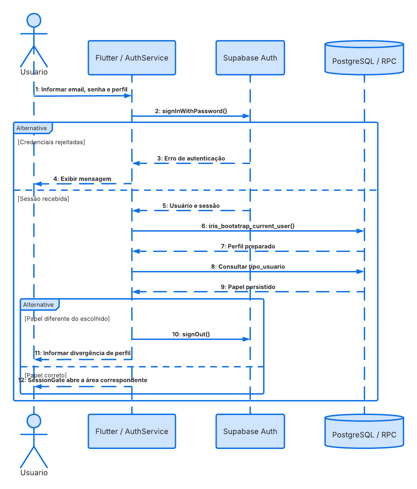
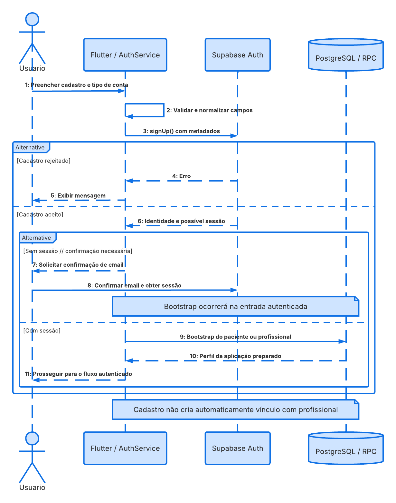
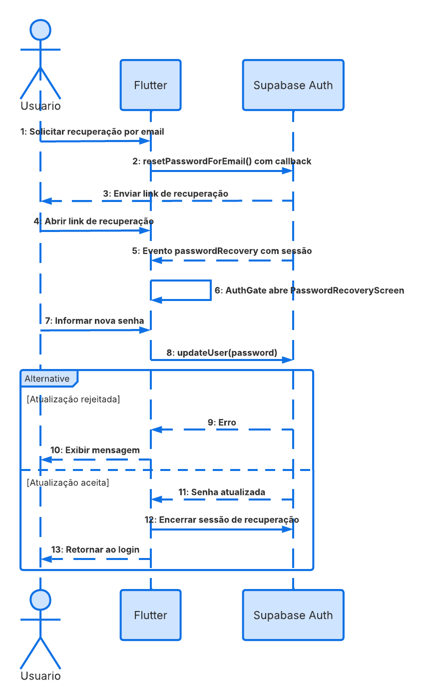
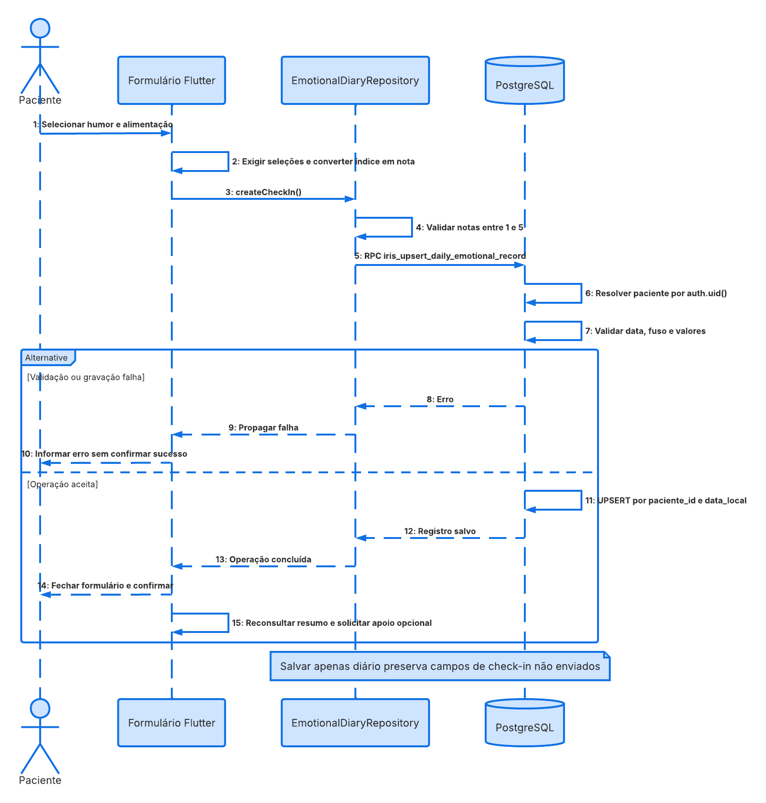
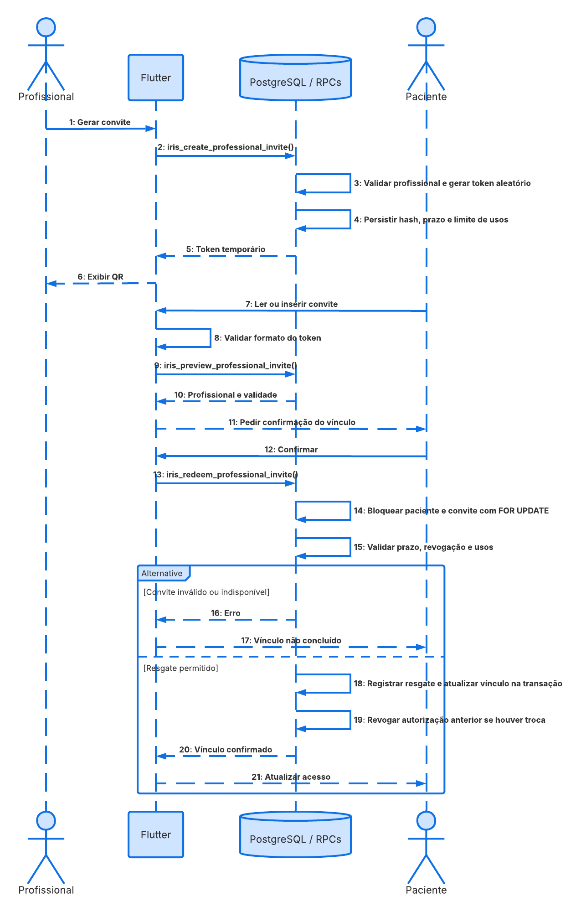
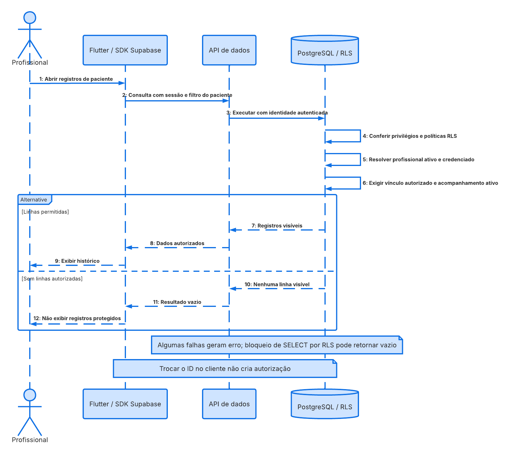
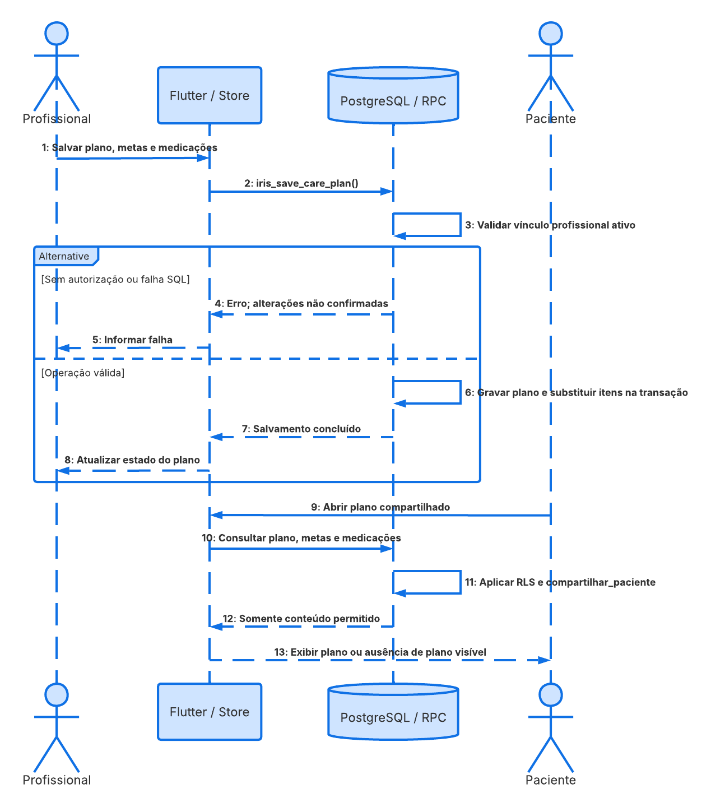
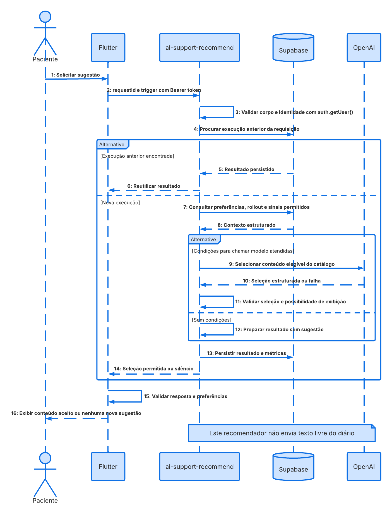
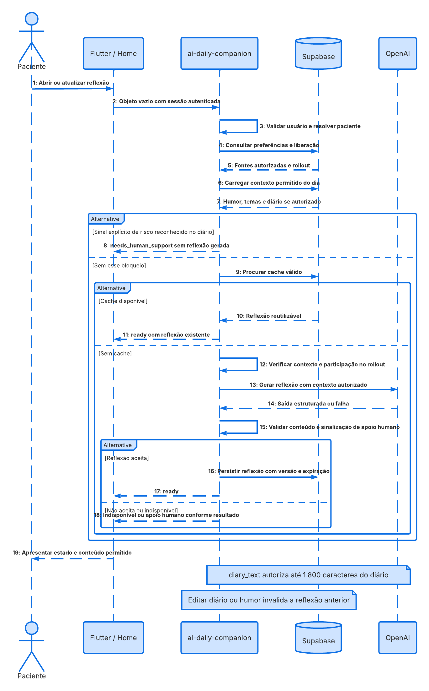
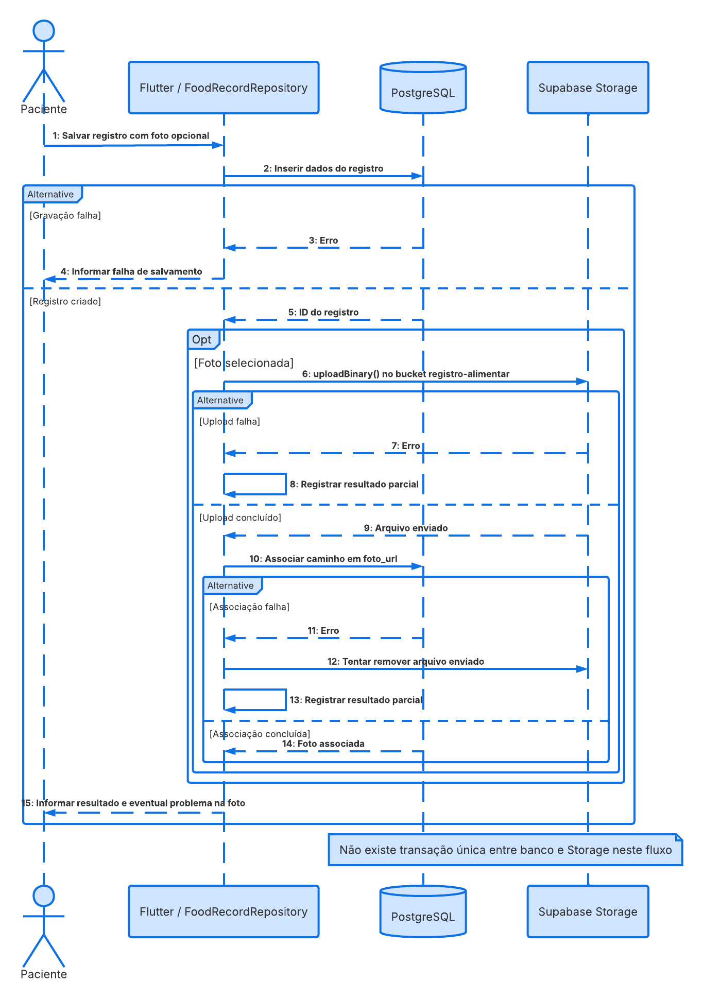

# Esquemas dos principais fluxos do Íris

Este guia reúne **10 diagramas de sequência**, baseados no código atual, para estudar a comunicação entre usuário, aplicativo e servidor. Cada esquema possui uma imagem local, versão editável no Lucid, termos técnicos explicados e uma pergunta para treinar.

## Como ler os desenhos

- Leia **de cima para baixo**: essa é a ordem das mensagens.
- Cada **coluna** representa um participante: usuário, aplicativo, serviço ou banco.
- **Seta contínua:** pedido ou chamada de operação.
- **Seta tracejada:** resposta ou resultado.
- Seta que retorna à mesma coluna: processamento interno naquele participante.
- **Alternative / alt:** caminhos alternativos; ocorre o ramo cuja condição é atendida.
- **Opt:** trecho opcional, como enviar uma foto.
- Os números ajudam a localizar mensagens. Não são linhas do código nem significam que todos os ramos são executados.

**Flutter e seus repositórios Dart executam no cliente. PostgreSQL/RPCs e Edge Functions executam no servidor.** As chamadas às RPCs são transportadas pela API do Supabase, resumida nos esquemas que mostram diretamente repositório e PostgreSQL.

## Escopo e simplificações

Os desenhos agrupam etapas internas para facilitar a leitura. A ordem detalhada das instruções está nos arquivos-fonte, especialmente dentro das transações. O fluxo de QR representa o resgate novo bem-sucedido; repetição/idempotência é aprofundada na [defesa do backend](../defesa_backend.md).

Erros de transporte, inicialização e configuração não são expandidos em todas as páginas. Nos fluxos de IA, a validação de identidade é pré-requisito; recusas antecipadas por consentimento, configuração, contexto ou rollout podem encerrar a operação antes da chamada ao modelo. A reflexão mostra o percurso após habilitação, incluindo cache e bloqueios de geração.

O desenho é uma fotografia do código, não uma comprovação de publicação ou funcionamento do ambiente remoto. Não representa as etapas internas do fornecedor de autenticação, treinamento de modelo, notificações remotas de emergência ou sincronização offline. Não foram adicionados componentes hipotéticos; as fontes estão indicadas em cada seção.

## Índice

1. [Login e autenticação](#fluxo-1)
2. [Cadastro e criação de perfil](#fluxo-2)
3. [Recuperação de senha](#fluxo-3)
4. [Check-in e diário: gravação por RPC](#fluxo-4)
5. [Convite QR e vínculo autorizado](#fluxo-5)
6. [Autorização de consulta aos registros](#fluxo-6)
7. [Plano de cuidado e compartilhamento](#fluxo-7)
8. [IA: seleção de sugestão de apoio](#fluxo-8)
9. [IA: reflexão diária com contexto autorizado](#fluxo-9)
10. [Registro alimentar e upload de foto](#fluxo-10)

## 1. Login e autenticação

A senha é verificada pelo Supabase Auth. Depois, o aplicativo prepara o perfil e confere o papel persistido antes de abrir a área correspondente.

[Editar no Lucid](https://lucid.app/lucidchart/6a1f4a40-c312-4741-ab48-0207ebee9149/edit) · [Abrir PNG](imagens/01-login.png) · [Fonte PlantUML](fontes/01-login.puml)

**Termos para entender:** Autenticação confirma a identidade; papel identifica paciente ou profissional; bootstrap prepara/valida o perfil da aplicação.

**Pergunta da banca:** Se alguém escolher “Sou profissional”, vira profissional?

**Resposta-base:** Não. O papel escolhido é comparado com o papel da conta no banco; divergência encerra a sessão.

**Onde conferir:** [auth_service.dart](../../lib/features/auth/auth_service.dart), [session_gate.dart](../../lib/screens/session_gate.dart), [main.dart](../../lib/main.dart).

## 2. Cadastro e criação de perfil

Criar a identidade e preparar o perfil são etapas diferentes. Quando não existe sessão após o cadastro, o fluxo pede confirmação de email; o bootstrap acontece na entrada autenticada.

[Editar no Lucid](https://lucid.app/lucidchart/8dcfa2d5-8cdc-43b6-aa98-9c29ce3c999e/edit) · [Abrir PNG](imagens/02-cadastro.png) · [Fonte PlantUML](fontes/02-cadastro.puml)

**Termos para entender:** Identidade é a conta no Auth; perfil são os registros da aplicação; metadados são informações iniciais enviadas no cadastro.

**Pergunta da banca:** O cadastro já vincula o paciente a alguém?

**Resposta-base:** Não automaticamente. O vínculo depende de confirmação pelo fluxo de convite ou pelo fluxo específico de demonstração.

**Onde conferir:** [auth_service.dart](../../lib/features/auth/auth_service.dart), [user_repository.dart](../../lib/features/users/user_repository.dart).

## 3. Recuperação de senha

O usuário recebe um link que retorna ao aplicativo. O evento de recuperação abre a tela de nova senha; depois da atualização o código encerra a sessão e retorna ao login.

[Editar no Lucid](https://lucid.app/lucidchart/5c54070e-97e4-4188-ad41-aa6793828d42/edit) · [Abrir PNG](imagens/03-recuperacao.png) · [Fonte PlantUML](fontes/03-recuperacao.puml)

**Termos para entender:** Callback é o endereço de retorno; evento é um aviso emitido pelo Auth; sessão de recuperação permite atualizar a senha nas condições do serviço.

**Pergunta da banca:** O aplicativo recebe a senha antiga?

**Resposta-base:** Não precisa recuperá-la. O fluxo permite definir uma nova senha mediante a autorização do serviço de autenticação.

**Onde conferir:** [auth_service.dart](../../lib/features/auth/auth_service.dart), [password_recovery_screen.dart](../../lib/screens/password_recovery_screen.dart), [auth_recovery_replay.dart](../../lib/features/auth/auth_recovery_replay.dart).

## 4. Check-in e diário: gravação por RPC

O formulário e o repositório validam a entrada, e a RPC executa a gravação no PostgreSQL. O sucesso é apresentado após a chamada concluir sem erro.

[Editar no Lucid](https://lucid.app/lucidchart/35bd947b-43c2-4c87-afb9-5faed268ada0/edit) · [Abrir PNG](imagens/04-checkin.png) · [Fonte PlantUML](fontes/04-checkin.puml)

**Termos para entender:** RPC chama uma função no banco; upsert insere ou atualiza; chave única impede duas linhas para a mesma combinação de paciente e dia.

**Pergunta da banca:** O que impede dois check-ins criarem linhas duplicadas?

**Resposta-base:** A restrição única por paciente e data local, combinada com o upsert no banco. A RPC preserva campos que aquela ação não altera.

**Onde conferir:** [check_in_diario_bottom_sheet.dart](../../lib/widgets/bottom_sheets/check_in_diario_bottom_sheet.dart), [emotional_diary_repository.dart](../../lib/features/emotional_diary/emotional_diary_repository.dart), [0009_patient_journal_improvements.sql](../../supabase/migrations/0009_patient_journal_improvements.sql).

## 5. Convite QR e vínculo autorizado

O profissional gera um convite. O paciente confere a identificação e confirma. O banco controla validade e concorrência antes de atualizar o vínculo.

[Editar no Lucid](https://lucid.app/lucidchart/a9e70c9c-5eef-4fce-9797-f95aefa56b3b/edit) · [Abrir PNG](imagens/05-vinculo.png) · [Fonte PlantUML](fontes/05-vinculo.puml)

**Termos para entender:** Token é o código do convite; hash é a impressão digital persistida; FOR UPDATE bloqueia linhas durante a transação; transação confirma ou desfaz alterações em conjunto.

**Pergunta da banca:** Por que validar o QR no aplicativo e no banco?

**Resposta-base:** O aplicativo confere o formato; o servidor confere se o convite existe e pode ser usado. Um código bem formatado ainda pode estar expirado ou revogado.

**Onde conferir:** [professional_repository.dart](../../lib/features/professional/professional_repository.dart), [patient_professional_repository.dart](../../lib/features/patient_professional/patient_professional_repository.dart), [0007_professional_invite_legacy_text_compat.sql](../../supabase/migrations/0007_professional_invite_legacy_text_compat.sql).

## 6. Autorização de consulta aos registros

A sessão acompanha a consulta. O banco verifica quais registros o profissional pode visualizar. Alterar o ID usado como filtro não cria uma autorização.

[Editar no Lucid](https://lucid.app/lucidchart/5cad7b1d-a843-4a45-b6f9-a77ee17eb4ef/edit) · [Abrir PNG](imagens/06-permissoes.png) · [Fonte PlantUML](fontes/06-permissoes.puml)

**Termos para entender:** Autorização determina o acesso; RLS restringe linhas; privilégio permite uma operação como SELECT. A leitura precisa atender às verificações aplicáveis.

**Pergunta da banca:** Se a RLS negar acesso, sempre aparece erro 403?

**Resposta-base:** Não. Um SELECT pode retornar nenhuma linha visível. Outros erros também são possíveis; resultado vazio exige verificar dados e permissões.

**Onde conferir:** [0006_professional_backend.sql](../../supabase/migrations/0006_professional_backend.sql), [0008_clinical_data_integrity.sql](../../supabase/migrations/0008_clinical_data_integrity.sql).

## 7. Plano de cuidado e compartilhamento

O profissional salva o plano com seus itens por uma RPC. O paciente consulta somente o plano permitido pelo vínculo e marcado como compartilhado.

[Editar no Lucid](https://lucid.app/lucidchart/e384bff8-cdee-4b3a-a039-5bdb65c086a5/edit) · [Abrir PNG](imagens/07-plano.png) · [Fonte PlantUML](fontes/07-plano.puml)

**Termos para entender:** Atomicidade significa confirmar as alterações juntas. Compartilhamento é uma condição de acesso; a store mantém o estado exibido no cliente.

**Pergunta da banca:** Por que não salvar plano, metas e medicações em chamadas independentes?

**Resposta-base:** Uma falha entre chamadas poderia deixar o plano incompleto. A função SQL reúne essas mudanças em uma operação transacional.

**Onde conferir:** [supabase_professional_workspace_backend.dart](../../lib/features/professional/data/supabase_professional_workspace_backend.dart), [patient_care_plan_repository.dart](../../lib/features/care_plan/patient_care_plan_repository.dart), [0006_professional_backend.sql](../../supabase/migrations/0006_professional_backend.sql).

## 8. IA: seleção de sugestão de apoio

O aplicativo envia um identificador da requisição e o gatilho. A função busca sinais estruturados permitidos, seleciona candidatos e pede ao modelo uma escolha de catálogo.

[Editar no Lucid](https://lucid.app/lucidchart/deedbb66-5e41-4722-84d5-9589b4b1ab80/edit) · [Abrir PNG](imagens/08-sugestoes.png) · [Fonte PlantUML](fontes/08-sugestoes.puml)

**Termos para entender:** requestId identifica a requisição; trigger informa sua origem; rollout controla a liberação; silêncio significa não entregar nova sugestão.

**Pergunta da banca:** Essa IA escreve um conselho livre a partir do diário?

**Resposta-base:** Não neste fluxo. Ela seleciona conteúdo predefinido com sinais estruturados. O texto livre do diário fica fora desse contrato.

**Onde conferir:** [remote_ai_recommender.dart](../../lib/features/ai_support/data/remote_ai_recommender.dart), [index.ts](../../supabase/functions/ai-support-recommend/index.ts), [ai_support_contract.ts](../../supabase/functions/_shared/ai_support_contract.ts).

## 9. IA: reflexão diária com contexto autorizado

O backend resolve o contexto autorizado e pode reutilizar uma reflexão válida ou gerar uma nova. Sinais específicos reconhecidos podem encaminhar para apoio humano sem exibir reflexão gerada.

[Editar no Lucid](https://lucid.app/lucidchart/a4b21750-83d9-4a87-9b8b-2fa44370edc5/edit) · [Abrir PNG](imagens/09-reflexao.png) · [Fonte PlantUML](fontes/09-reflexao.puml)

**Termos para entender:** Cache é um resultado reutilizável; invalidação remove sua validade após mudanças; diary_text é a fonte de consentimento para usar o texto do diário.

**Pergunta da banca:** Por que o diário pode ir à OpenAI aqui e não no outro esquema?

**Resposta-base:** São contratos diferentes. A reflexão pode usar o texto com consentimento específico; o recomendador de catálogo não usa esse texto.

**Onde conferir:** [index.ts](../../supabase/functions/ai-daily-companion/index.ts), [daily_companion_repository.dart](../../lib/features/ai_support/data/daily_companion_repository.dart), [0013_daily_companion_refresh.sql](../../supabase/migrations/0013_daily_companion_refresh.sql).

## 10. Registro alimentar e upload de foto

O registro é persistido no PostgreSQL. Quando existe foto, o arquivo vai para o Storage e o caminho é associado ao registro. Uma falha na foto pode resultar em salvamento parcial.

[Editar no Lucid](https://lucid.app/lucidchart/48625332-561d-4c08-82fe-fe1c6709b7f6/edit) · [Abrir PNG](imagens/10-foto.png) · [Fonte PlantUML](fontes/10-foto.puml)

**Termos para entender:** Storage guarda arquivos; foto_url armazena o caminho; compensação é uma tentativa de desfazer uma etapa quando a seguinte falha.

**Pergunta da banca:** A foto e o registro estão na mesma transação?

**Resposta-base:** Não. São operações separadas. O código tenta limpar o arquivo em alguns erros e comunica problemas parciais.

**Onde conferir:** [food_record_repository.dart](../../lib/features/food/food_record_repository.dart).

## Como estudar

Comece por login (1), check-in (4), permissões (6), vínculo (5) e plano (7). Depois compare os dois fluxos de IA (8 e 9).

Cubra a resposta-base e tente contar cada desenho: **quem inicia, quem valida, onde executa, o que muda e o que acontece se falhar**. Se conseguir explicar as setas, você está entendendo o funcionamento, além de reconhecer os nomes.

## Arquivos e verificação

As imagens PNG foram exportadas dos documentos Lucid e inspecionadas visualmente. A verificação de texto/contraste do canvas não apontou problemas. Os arquivos PlantUML permitem consultar a fonte usada; as versões editáveis podem ser alteradas no Lucid. Mudanças nesses documentos não atualizam automaticamente os PNGs ou fontes deste repositório: reexporte e revise quando o código mudar.

Este trabalho documenta os fluxos; não executou os testes funcionais do aplicativo nem alterou o backend.
